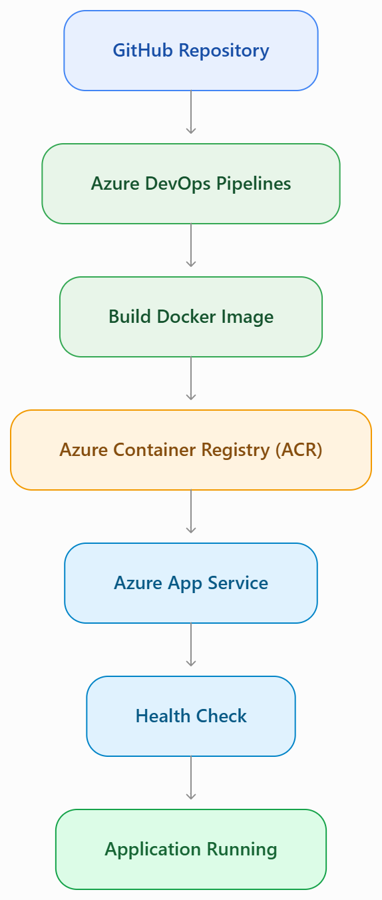
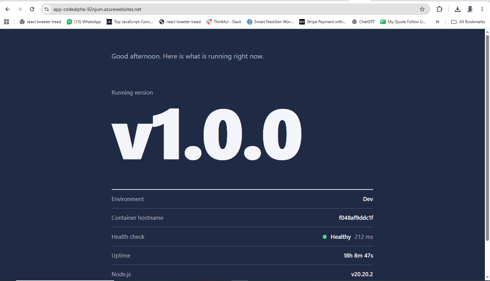
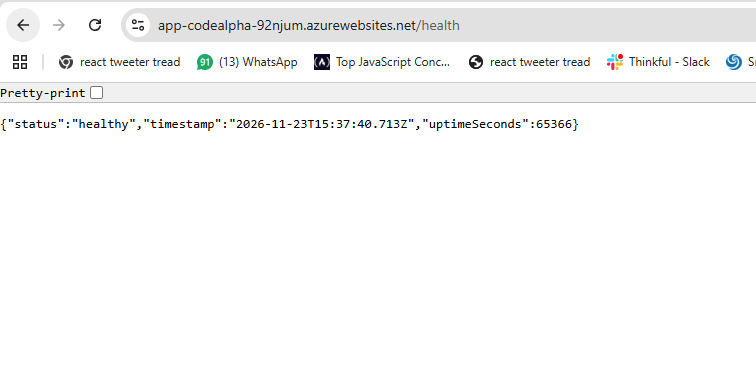
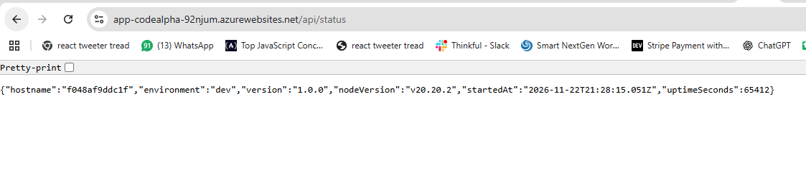
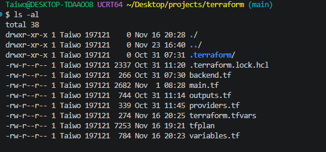
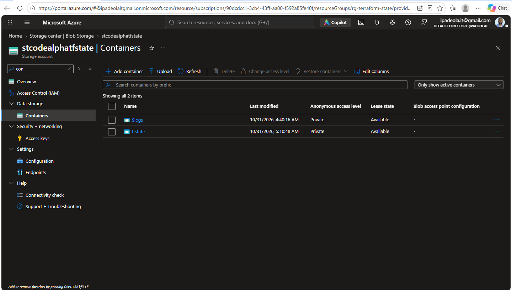
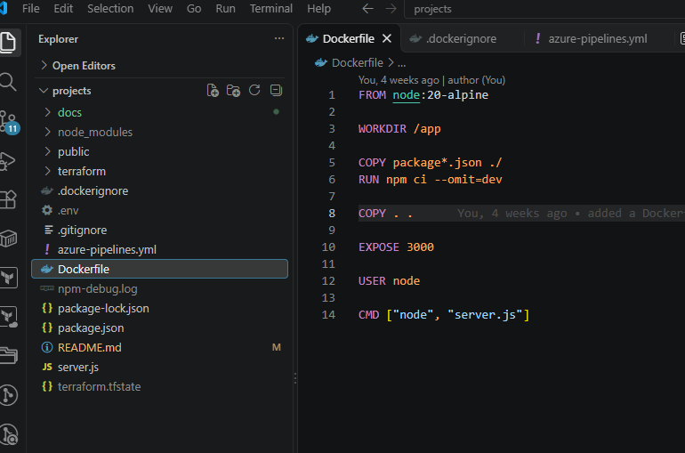
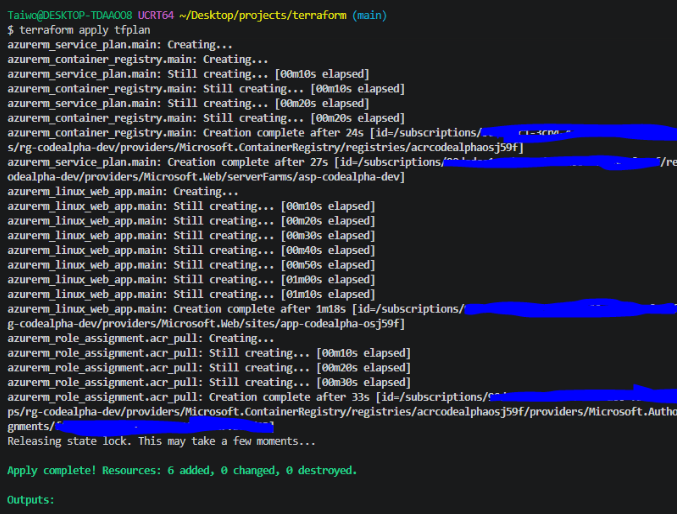

# CodeAlpha_Project 1

# DevOps Status Dashboard: Azure Deployment with Terraform and Azure Pipelines

CodeAlpha Project 1 deployment architecture showing how source code moves through the CI/CD pipeline, gets stored in Azure Container Registry, and is deployed to Azure App Service.


## About the project

This project is part of my CodeAlpha DevOps training.

The goal was to take an existing Node.js application, containerise it with Docker, provision the required Azure infrastructure using Terraform, and automate its deployment with Azure DevOps Pipelines.

I wanted to understand how the different parts work together, from building an application image to making it available through Azure App Service.

The application is a simple DevOps Status Dashboard built with Node.js and Express. It provides a health endpoint and an API endpoint that returns information about the running application.

## Live application

**Application URL:** https://app-codealpha-92njum.azurewebsites.net


**Health check:** https://app-codealpha-92njum.azurewebsites.net/health


**Application status:** https://app-codealpha-92njum.azurewebsites.net/api/status


The application was deployed successfully and both endpoints returned successful responses after the pipeline deployment.


## Technologies used

- Azure
- Terraform
- Docker
- Azure Container Registry (ACR)
- Azure App Service
- Azure DevOps Pipelines
- GitHub
- Node.js
- Express.js
- Azure CLI

## Architecture

The deployment follows this process:

1. Application source code is maintained in GitHub.
2. Azure Pipelines builds the Docker image.
3. The image is pushed to Azure Container Registry.
4. Azure App Service pulls the image from ACR using its managed identity.
5. The application runs as a Linux container on Azure App Service.
6. The pipeline checks the application's health after deployment.

## Infrastructure

I used Terraform to provision the Azure resources instead of creating them manually through the Azure Portal.

The main resources include:

| Resource            | Configuration                       |
| ------------------- | ----------------------------------- |
| Resource Group      | rg-codealpha-dev                    |
| Region              | East US                             |
| Container Registry  | Azure Container Registry, Basic SKU |
| App Service Plan    | Linux, Basic B1                     |
| Web App             | Linux custom container              |
| Managed Identity    | System-assigned                     |
| Registry Permission | AcrPull                             |
| Application Port    | 3000                                |



Terraform state is stored remotely in Azure Storage. I used a separate resource group for the state storage to keep it independent of the application infrastructure.

The storage backend uses Microsoft Entra ID authentication rather than storing storage account keys in the Terraform configuration.



## Docker setup

Before building the Docker image, I first confirmed that the application could run locally.

I created a Dockerfile using Node.js 20 Alpine as the base image. I also added a `.dockerignore` file to prevent unnecessary files, such as local dependencies and Terraform files, from being included in the build context.

The application listens on port 3000 and binds to `0.0.0.0`, allowing it to receive connections from outside the container.



To build the image locally:

```bash
docker build -t devops-status-dashboard:1.0.0 .
```

To run the container:

```bash
docker run -d -p 3000:3000 \
  --name devops-dashboard-test \
  devops-status-dashboard:1.0.0
```

## Terraform deployment

Terraform was used to create and manage the Azure infrastructure.

The configuration includes the resource group, App Service Plan, Container Registry, Linux Web App and the role assignment required for the application to pull images from ACR.

I also configured a remote backend in Azure Storage so that Terraform state would not be kept only on my local machine.

The usual Terraform workflow is:

```bash
terraform init
terraform fmt -check
terraform validate
terraform plan
terraform apply
```



## CI/CD with Azure DevOps

I connected my GitHub repository to Azure DevOps and created a YAML-based pipeline.

The pipeline has two main stages.

**Build stage**

Azure Pipelines builds the Docker image and pushes it to Azure Container Registry using a versioned build tag.

**Deploy stage**

The pipeline connects to Azure through an Azure Resource Manager service connection. It updates the image configuration on Azure App Service, restarts the application and checks the `/health` endpoint.

The pipeline uses workload identity federation for Azure access. This avoids keeping an Azure client secret in the pipeline YAML.

The App Service uses its own system-assigned managed identity to pull images from ACR.


## Security considerations

A few security decisions were included in this project:

- HTTPS is enforced on the Web App.
- The App Service uses a managed identity to access ACR.
- The ACR pull permission is assigned through the AcrPull role.
- ACR admin authentication is disabled.
- Azure DevOps uses workload identity federation for Azure deployment access.
- Terraform state is stored remotely with identity-based access.
- Sensitive files and Terraform state files are excluded from Git and the Docker build context.

## Deployment verification

After deployment, I tested the live application using its two endpoints.

The health endpoint returned:

```json
{
  "status": "healthy"
}
```


The application status endpoint returned information including:

- Environment: dev
- Application version: 1.0.0
- Node.js version: v20.20.2

I also added a health check to the deployment pipeline so that a deployment does not finish successfully unless the application responds with HTTP 200.

## Challenges and lessons learned

This project involved a few issues that helped me understand the deployment process better.

During the first Docker build, I encountered an error because the Dockerfile referenced `index.js`, while the actual application entry point was `server.js`. I corrected the Dockerfile and rebuilt the image.

I also encountered an Azure quota issue when creating the Basic B1 App Service Plan in East US. I contacted Azure support to resolve the quota restriction before continuing.

Another issue occurred during deployment when App Service attempted to pull the container image from Docker Hub instead of Azure Container Registry. I investigated the App Service container configuration and corrected it to use the full ACR image path.

These experiences helped me understand the importance of checking application logs, verifying image configuration and testing the application after deployment.

## What I learned

Through this project, I gained practical experience with:

- Building and running Docker containers.
- Provisioning Azure infrastructure with Terraform.
- Configuring remote Terraform state.
- Managing Azure resources through Azure CLI.
- Using Azure Container Registry to store container images.
- Configuring managed identities and role-based access.
- Creating Azure DevOps YAML pipelines.
- Automating container deployment to Azure App Service.
- Troubleshooting deployment and container startup issues.

## Conclusion

This project gave me practical experience taking an application from a local development environment to a live Azure deployment.

It also helped me understand how Docker, Terraform, Azure services and CI/CD pipelines work together in a cloud deployment workflow.
