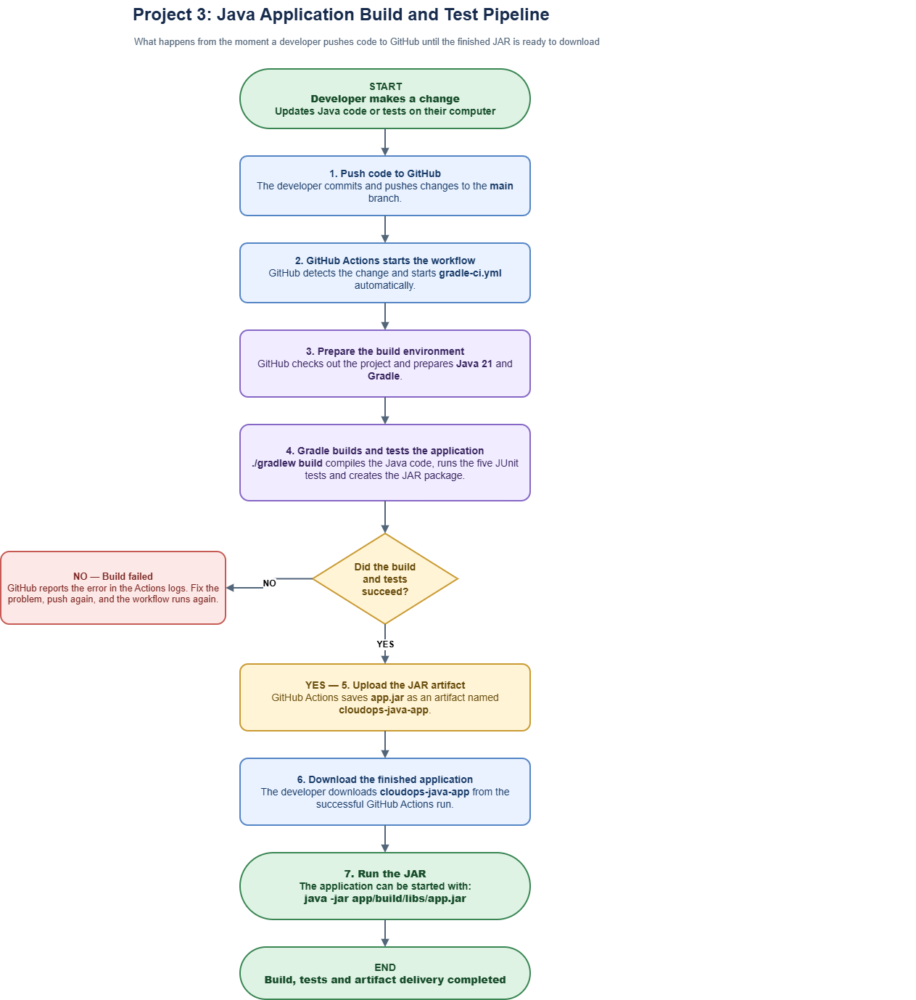

# Project 3: Java Application Using Gradle



## Overview

For this project, I built a simple Java application and used Gradle to automate its build process, manage dependencies, run tests, and generate an executable JAR file.

I also integrated GitHub Actions to automate the build and testing process whenever changes are pushed to the repository or a pull request is opened against the `main` branch.

The goal was to understand how Gradle fits into a Java development workflow and how CI automation helps maintain a consistent and reliable build process.

## Project Objectives

- Automate Java application builds using Gradle.
- Manage application and testing dependencies.
- Write and execute unit tests using JUnit 5.
- Generate an executable JAR file.
- Integrate GitHub Actions for continuous integration.
- Upload the generated JAR as a downloadable build artifact.

## Technologies Used

| Technology      | Purpose                                    |
| --------------- | ------------------------------------------ |
| Java 21         | Application development                    |
| Gradle 8.14.3   | Build automation and dependency management |
| JUnit 5         | Unit testing                               |
| Git and GitHub  | Version control and source code hosting    |
| GitHub Actions  | Continuous integration                     |
| Eclipse Temurin | Java Development Kit                       |

## Application Description

I created a Java application called **CloudOps Java Build Monitor**.

The application displays basic build information, including:

- Application name
- Application version
- Build status
- Java runtime version
- Initialization message

The application is intentionally simple. The main focus of this project is not application complexity but understanding how to automate the Java build and testing lifecycle.

## Project Structure

```text
Project_3_Java_Gradle/
│
├── app/
│   ├── src/
│   │   ├── main/
│   │   │   └── java/
│   │   │       └── com/codealpha/cloudops/
│   │   │           └── App.java
│   │   │
│   │   └── test/
│   │       └── java/
│   │           └── com/codealpha/cloudops/
│   │               └── AppTest.java
│   │
│   └── build.gradle
│
├── gradle/
│   ├── libs.versions.toml
│   └── wrapper/
│
├── gradlew
├── gradlew.bat
├── gradle.properties
├── settings.gradle
└── .gitignore
```

The Gradle Wrapper files allow other developers and CI environments to run the project using the configured Gradle version without installing Gradle globally.

## 1. Setting Up the Java Environment

I installed the Eclipse Temurin JDK 21 and verified the installation:

```bash
java -version
javac -version
```

I also downloaded Gradle and initialized the Java application project using the Java application template and JUnit Jupiter as the testing framework.

For subsequent build operations, I used the Gradle Wrapper included in the project.

## 2. Managing Dependencies with Gradle

I used the Gradle version catalog in:

`gradle/libs.versions.toml`

This file defines the dependency versions used by the application.

The project includes:

- Guava as an application dependency.
- JUnit Jupiter for unit testing.

Keeping dependency versions in one location makes them easier to maintain and update.

## 3. Running the Application

From the project directory, I ran:

```bash
./gradlew run
```

The application executed successfully and displayed:

```text
====================================
       CLOUDOPS BUILD MONITOR
====================================
Application: CloudOps Java Build Monitor
Version: 1.0.0
Build Status: SUCCESS
Java Version: 21.0.13.1
====================================
Build monitoring initialized successfully.
```

## 4. Running Unit Tests

I created five unit tests in `AppTest.java` to verify the application's methods.

The tests check:

1. Application name.
2. Application version.
3. Build status.
4. Java version.
5. Application greeting.

I executed the tests using:

```bash
./gradlew test
```

Gradle completed the tests successfully.

The generated HTML test report is available locally at:

```text
app/build/reports/tests/test/index.html
```

The test results showed:

- Tests: 5
- Failures: 0
- Ignored: 0
- Success rate: 100%


## 5. Building the Application

After verifying that the application and tests worked correctly, I ran:

```bash
./gradlew clean build
```

This command removes previous build output, compiles the application, executes the tests, and generates the build artifacts.

The build completed successfully.

The generated JAR file is located at:

```text
app/build/libs/app.jar
```

I also configured the JAR manifest with the application's main class so that it can be executed directly.

To run the generated JAR:

```bash
java -jar app/build/libs/app.jar
```

The application executed successfully from the generated JAR.

## 6. Automating the Build with GitHub Actions

To introduce continuous integration, I created a GitHub Actions workflow:

```text
.github/workflows/gradle-ci.yml
```

The workflow is stored at the repository root because GitHub Actions discovers workflows from the repository's `.github/workflows/` directory.

The pipeline is configured to run when:

- Changes are pushed to the `main` branch affecting Project 3.
- A pull request targeting `main` affects Project 3.
- The workflow is manually triggered.

### Pipeline stages

1. **Checkout:** Retrieves the repository source code.
2. **Set up Java:** Configures JDK 21 using Eclipse Temurin.
3. **Set up Gradle:** Prepares the Gradle environment.
4. **Build and Test:** Executes `./gradlew build`.
5. **Upload Artifact:** Uploads the generated JAR file as a GitHub Actions artifact.

### CI workflow

```yaml
name: Java Gradle CI

on:
  push:
    branches:
      - main
    paths:
      - "Project_3_Java_Gradle/**"
      - ".github/workflows/gradle-ci.yml"

  pull_request:
    branches:
      - main
    paths:
      - "Project_3_Java_Gradle/**"
      - ".github/workflows/gradle-ci.yml"

  workflow_dispatch:

jobs:
  build:
    name: Build and Test Java Application
    runs-on: ubuntu-latest

    defaults:
      run:
        working-directory: Project_3_Java_Gradle

    steps:
      - name: Checkout repository
        uses: actions/checkout@v4

      - name: Set up JDK 21
        uses: actions/setup-java@v4
        with:
          distribution: temurin
          java-version: "21"

      - name: Set up Gradle
        uses: gradle/actions/setup-gradle@v4

      - name: Run tests and build application
        run: ./gradlew build

      - name: Upload application JAR
        uses: actions/upload-artifact@v4
        with:
          name: cloudops-java-app
          path: Project_3_Java_Gradle/app/build/libs/*.jar
          if-no-files-found: error
```

[ci/cd](docs/screenshot/ci%20-%20cd%20pipeline%20code.PNG)

## 7. GitHub Actions Results

After pushing the project to GitHub, I checked the Actions tab to verify that the workflow executed successfully.

The pipeline completed all its major steps:

- Repository checkout successful.
- Java 21 setup successful.
- Gradle setup successful.
- Application compilation successful.
- Unit tests successful.
- JAR generation successful.
- Artifact upload successful.

The workflow reported:

```text
BUILD SUCCESSFUL
```

GitHub Actions also confirmed that the `cloudops-java-app` artifact was uploaded successfully.

The artifact can be downloaded from the successful workflow run under the Actions tab.


## What I Learned

This project helped me understand how Gradle supports Java application development beyond simply compiling source code.

Some of the key things I learned include:

- How to initialize and structure a Java application using Gradle.
- How to use the Gradle Wrapper to maintain a consistent build environment.
- How to manage dependencies using a version catalog.
- How to write and execute unit tests with JUnit 5.
- How to generate and execute a JAR file.
- How to configure GitHub Actions for automated Java builds and tests.
- How to publish build artifacts from a CI pipeline.
- Why CI pipelines should verify code before an artifact is delivered.

One important lesson was that a successful local build does not automatically guarantee that the same build will work in a CI environment. I encountered a Gradle Wrapper permission issue on GitHub Actions, which I resolved by correcting the executable permission on the wrapper script.

## Conclusion

This project gave me practical experience with Java build automation using Gradle and continuous integration using GitHub Actions.

I was able to build the application locally, run five successful unit tests, generate an executable JAR, and automate the same build process through GitHub Actions.

It was a useful exercise in understanding how build automation, testing, and artifact management fit into a DevOps workflow.

## Repository

**GitHub:** [CodeAlpha DevOps Internship Projects](https://github.com/highpee1991/CodeAlpha_ProjectName)

**Project directory:** `Project_3_Java_Gradle`

**CI workflow:** `.github/workflows/gradle-ci.yml`
