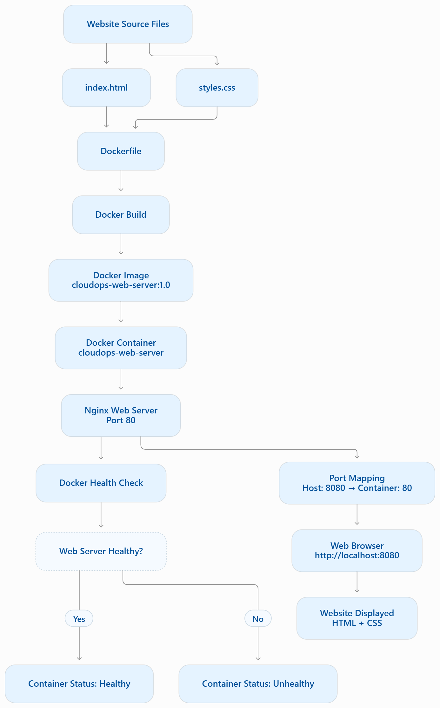
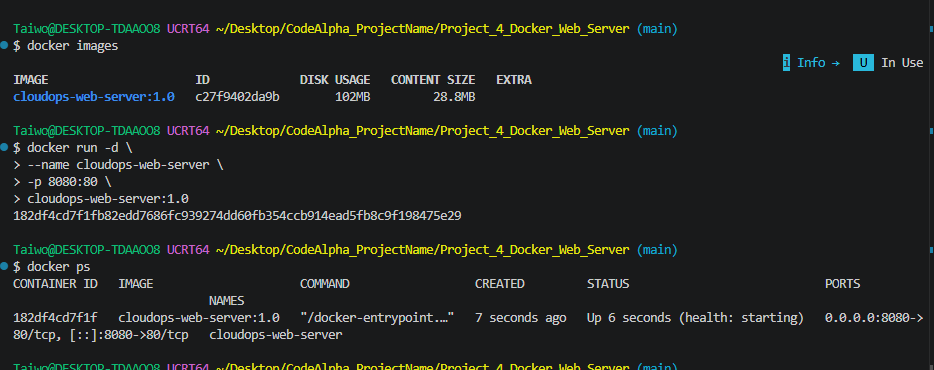
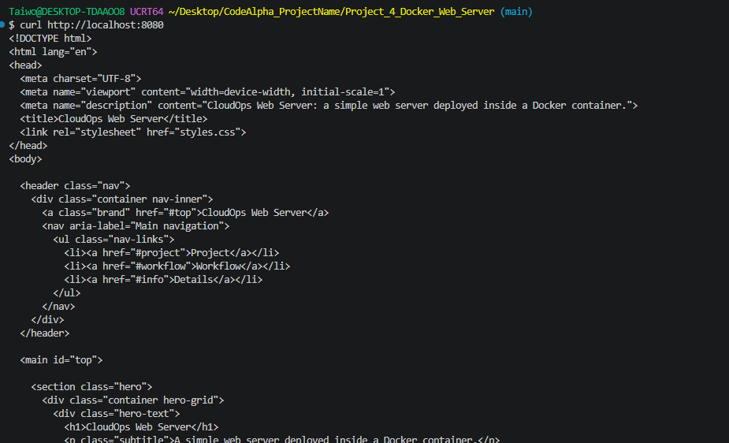

# CloudOps Web Server: Dockerized Nginx Web Server



## Project Overview

This project demonstrates how I containerized a static website using Docker and Nginx.

The goal was to build a simple web server, package the website files into a Docker image, run the image as a container, and verify that the web server was serving the website correctly.

I used Nginx because it is lightweight, reliable, and well suited for serving static HTML and CSS files.

## Technologies Used

- Docker
- Nginx
- HTML5
- CSS3
- Git and GitHub

## Project Structure

```text
Project_4_Docker_Web_Server/
│
├── docs/
│   └── screenshots/
│       ├── container.PNG
│       ├── curl css.PNG
│       ├── curl.PNG
│       ├── docker build.PNG
│       ├── docker desktop container.PNG
│       ├── docker destop image.PNG
│       ├── docker health bash.PNG
│       ├── flowchat.png
│       └── website.PNG
│
├── index.html
├── styles.css
├── Dockerfile
└── README.md
```

## How It Works

The project follows a straightforward containerization workflow:

1. I created a static website using HTML and CSS.
2. I selected the official lightweight Nginx Alpine image as the base image.
3. I copied the website files into Nginx's default web directory inside the container.
4. I exposed port 80, which is the port Nginx uses to serve HTTP traffic.
5. I added a Docker health check to monitor whether the web server was responding.
6. I built the Docker image and ran it as a container.
7. I mapped port 8080 on my computer to port 80 inside the container.

## Understanding the Dockerfile

```dockerfile
FROM nginx:alpine

COPY index.html /usr/share/nginx/html/index.html
COPY styles.css /usr/share/nginx/html/styles.css

EXPOSE 80

HEALTHCHECK --interval=30s --timeout=3s \
    CMD wget -qO- http://127.0.0.1/ || exit 1
```

Here is what each instruction does:

**FROM nginx:alpine**

Uses the official lightweight Nginx Alpine image as the base image.

**COPY index.html /usr/share/nginx/html/index.html**

Copies the website's HTML file into the directory where Nginx serves web content.

**COPY styles.css /usr/share/nginx/html/styles.css**

Copies the stylesheet into the same web directory so the HTML page can load its styling.

**EXPOSE 80**

Documents that the container's web server listens on port 80.

**HEALTHCHECK**

Checks the web server at regular intervals. If Nginx stops responding successfully, Docker can report the container as unhealthy.

## Building the Docker Image

I built the Docker image using:

```bash
docker build -t cloudops-web-server:1.0 .
```

The command creates an image named `cloudops-web-server` with the tag `1.0`.


## Running the Container

I started the container using:

```bash
docker run -d --name cloudops-web-server -p 8080:80 cloudops-web-server:1.0
```

The port mapping is important:

- `8080` is the port on my computer.
- `80` is the port inside the Docker container.

This means I can access the website from my browser at:

http://localhost:8080



## Verifying the Deployment

After starting the container, I performed several checks.

**1. Check the running container**

```bash
docker ps
```

This confirms that the container is running and shows the port mapping.

**2. Check the container health**

```bash
docker inspect --format='{{.State.Health.Status}}' cloudops-web-server
```

The expected result is:

```text
healthy
```


**3. Test the website response**

```bash
curl http://localhost:8080
```

This confirms that the web server returns the website's HTML content.



**4. Test the CSS file**

```bash
curl -I http://localhost:8080/styles.css
```

The expected HTTP response is `200 OK`, confirming that Nginx can serve the stylesheet.


## Stopping and Removing the Container

When I finished testing, I could stop and remove the container using:

```bash
docker stop cloudops-web-server
docker rm cloudops-web-server
```

The Docker image remains available locally unless it is removed separately.

## What I Learned

This project helped me understand the practical process of containerizing a static website.

I learned how to select an appropriate base image, copy application files into a container, understand Docker port mapping, build and run an image, and use Docker health checks to monitor a running container.

I also learned that exposing a containerized web application locally does not automatically make it publicly accessible. The port mapping allows access from my computer, while public access would require an appropriate hosting environment and network configuration.

## Project Repository

[View the CodeAlpha Projects Repository](https://github.com/highpee1991/CodeAlpha_ProjectName)

[View Project 4: Docker Web Server](https://github.com/highpee1991/CodeAlpha_ProjectName/tree/main/Project_4_Docker_Web_Server)
